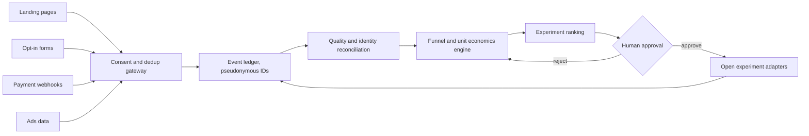

# SignalStack: architecture and evidence model

## Long-term architecture (not built)



## Implemented in v0.1

- `src/engine.js`: pure analysis, time-window filtering, event-ID and order-ID dedup, unique stage counts, funnel rates, ad-spend-only comparison, simple first-observed-channel grouping, caveats, and stage-loss hypothesis.
- `src/cli.js`: local file input, JSON report output.
- `index.html`: browser-based JSON import and simple visualization. Runs locally, no network calls.
- `tests`: synthetic deterministic cases, invalid inputs, duplicates, zeros and time windows.

## Proposed open event envelope

```json
{
  "schemaVersion": "0.1-draft",
  "eventId": "a-stable-id-shared-by-browser-and-server",
  "personId": "pseudonymous-id-consented-and-scoped",
  "type": "purchase",
  "orderId": "merchant-order-id",
  "valueINR": 499,
  "at": "2026-11-02T09:03:00+05:30",
  "source": "server"
}
```

This is a **draft schema sketch**, not a published interoperability standard. Avoid storing raw names, emails, IPs, payment details, or access tokens. Future connectors must obey applicable consent rules and track source of truth for a purchase.

## Hard open problems

1. **Identity and privacy**: how to reconcile cross-device behavior without invasive tracking or fingerprinting.
2. **Attribution**: observational channel assignment cannot show lift; controlled experiments are needed.
3. **Returns and subscriptions**: orders, renewals, refund windows, tax and contribution margin require a real money ledger.
4. **Experiment causality**: avoid treating before/after fluctuations as proven effects.
5. **Trustworthy automation**: any changes to live ad spend, price or checkout must require explicit authorization, dry runs, and rollback.

## Design constraint

The current analytics are a *period snapshot*, not path-ordered journey cohorts. Some users may enter checkout without opting in or purchase after the window. Future cohort models must address this explicitly.
